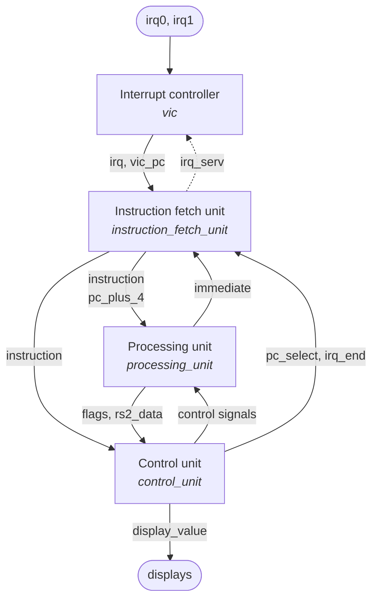
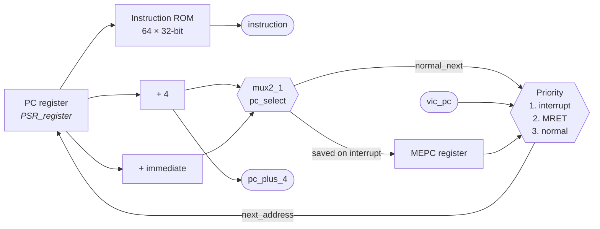
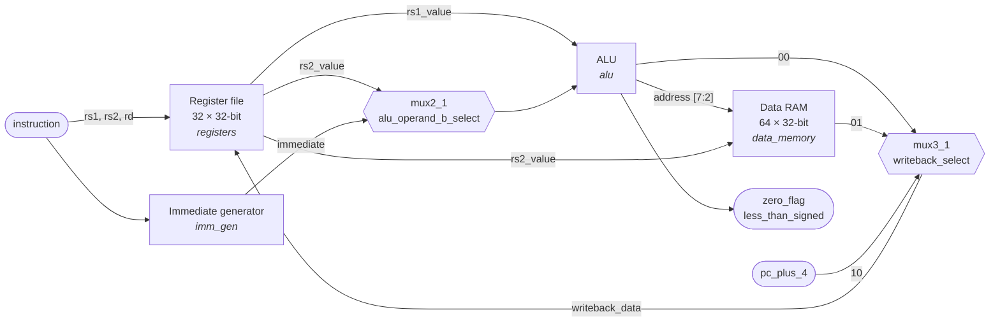
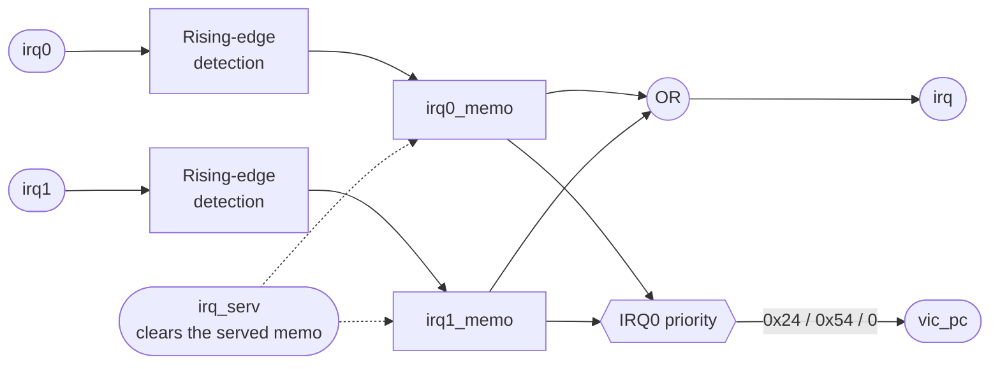
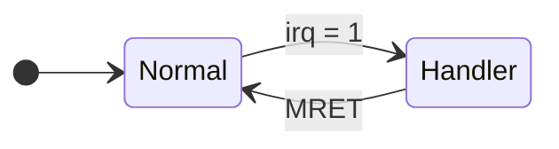
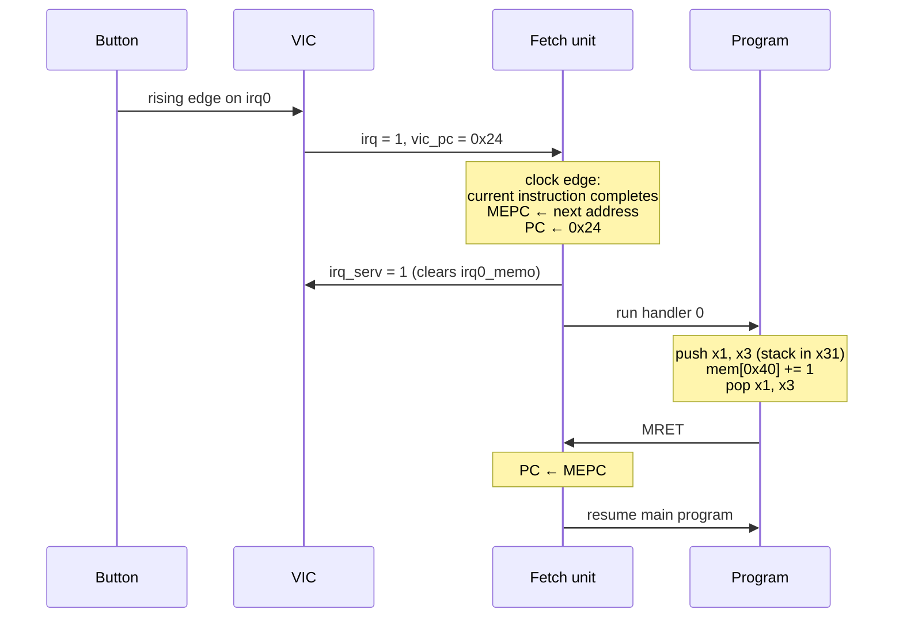
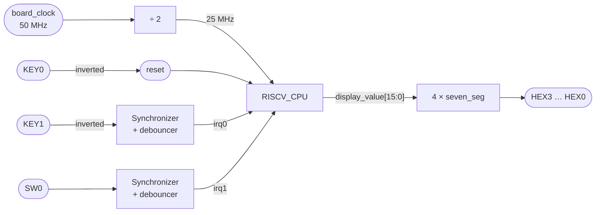

# Single-cycle RISC-V CPU in VHDL

32-bit single-cycle RISC-V processor (RV32I subset) with a vectored interrupt controller. Simulated with GHDL, running on a Terasic DE10-Lite (MAX 10) with Quartus Prime Lite.

| | |
|---|---|
| Instructions | `LUI` `ADDI` `ADD` `SUB` `LW` `SW` `BEQ` `BNE` `BLT` `JAL` `MRET` |
| Registers | 32 × 32-bit, `x0` hardwired to 0 |
| Memory | 64-word instruction ROM, 64-word data RAM |
| Interrupts | 2 external sources, IRQ0 has priority |
| Board | DE10-Lite (`10M50DAF484C7G`), output on 4 seven-segment displays |

## Architecture



### Instruction fetch unit



Branch and jump targets are `PC + imm`, relative to the branch itself. The ROM is indexed by `PC[7:2]`.

### Processing unit



| `alu_control` | Operation | Used by |
|---|---|---|
| `000` | `A + B` | `ADD` `ADDI` `LW` `SW` |
| `001` | `A − B` | `SUB`, branches |
| `010` / `011` / `100` | `and` / `or` / `xor` | — |
| `101` / `110` | `A < B` signed / unsigned | — |
| `111` | `B` | `LUI` |

| `immediate_format` | Format | Immediate |
|---|---|---|
| `000` | I | `SignExt(instr[31:20])` |
| `001` | S | `SignExt(instr[31:25] & instr[11:7])` |
| `010` | B | `SignExt(instr[31] & instr[7] & instr[30:25] & instr[11:8] & '0')` |
| `011` | U | `instr[31:12] & x"000"` |
| `100` | J | `SignExt(instr[31] & instr[19:12] & instr[20] & instr[30:21] & '0')` |

### Control unit

RISC-V has no status register: branches use the ALU flags computed in the same cycle. The display register latches the value written by every `SW`.

| Instruction | `pc_select` | `reg_write` | `imm` | `alu_b` | `alu` | `mem_write` | `writeback` | `display` |
|---|---|---|---|---|---|---|---|---|
| `ADD`  | 0 | 1 | — | rs2 | ADD | 0 | ALU | 0 |
| `SUB`  | 0 | 1 | — | rs2 | SUB | 0 | ALU | 0 |
| `ADDI` | 0 | 1 | I | imm | ADD | 0 | ALU | 0 |
| `LUI`  | 0 | 1 | U | imm | PASS_B | 0 | ALU | 0 |
| `LW`   | 0 | 1 | I | imm | ADD | 0 | memory | 0 |
| `SW`   | 0 | 0 | S | imm | ADD | 1 | — | 1 |
| `BEQ`  | `Z` | 0 | B | rs2 | SUB | 0 | — | 0 |
| `BNE`  | `not Z` | 0 | B | rs2 | SUB | 0 | — | 0 |
| `BLT`  | `LT` | 0 | B | rs2 | SUB | 0 | — | 0 |
| `JAL`  | 1 | 1 | J | — | — | 0 | PC + 4 | 0 |
| `MRET` | 0 | 0 | — | — | — | 0 | — | 0 |

`MRET` also asserts `irq_end`. Unknown instructions write nothing.

## Interrupts



| Source | Vector | Handler effect |
|---|---|---|
| IRQ0 | `0x24` | `mem[0x40] += 1` |
| IRQ1 | `0x54` | `mem[0x40] += 2` |



| Transition | On the clock edge |
|---|---|
| Normal → Handler | `PC ← vic_pc`, `MEPC ←` next normal address, `in_interrupt ← 1`, `irq_serv = 1` |
| Handler → Normal | `PC ← MEPC`, `in_interrupt ← 0` |
| Inside a handler | `irq` is ignored (no nesting) |

The interrupted instruction completes on the same edge, so `MEPC` holds the instruction that would have come next (`PC + 4`, or the target of a taken branch or `JAL`). No instruction is skipped or executed twice.



## FPGA



| Port | Board | Pin |
|---|---|---|
| `board_clock` | 50 MHz clock | `P11` |
| `reset_button` | KEY0 | `B8` |
| `irq0_button` | KEY1 | `A7` |
| `irq1_switch` | SW0 | `C10` |
| `hex_0[6:0]` | HEX0 | `C17 D17 E16 C16 C15 E15 C14` |
| `hex_1[6:0]` | HEX1 | `B17 A18 A17 B16 E18 D18 C18` |
| `hex_2[6:0]` | HEX2 | `B22 C22 B21 A21 B19 A20 B20` |
| `hex_3[6:0]` | HEX3 | `E17 D19 C20 C19 E21 E22 F21` |

| Generic | Default | Meaning |
|---|---|---|
| `RESET_ACTIVE_LOW` | `true` | Reset button is active low |
| `SEGMENTS_ACTIVE_LOW` | `true` | Segments light on 0 |
| `CLOCK_DIVIDE_EXPONENT` | `1` | CPU clock = 50 MHz / 2ⁿ |
| `IRQ0_ACTIVE_LOW` | `true` | IRQ0 on a push button |
| `IRQ1_ACTIVE_LOW` | `false` | IRQ1 on a slide switch |
| `DEBOUNCE_COUNTER_BITS` | `18` | 2¹⁸ cycles ≈ 10 ms at 25 MHz |

## Test programs

**Array sum** — adds the words 1 to 10 stored at `0x40`–`0x64`. Display: **`0037`**.

```asm
_main:  addi x1, x0, 0x40
        addi x2, x0, 0
        addi x3, x0, 0x68
_loop:  lw   x10, 0(x1)
        add  x2, x2, x10
        addi x1, x1, 4
        blt  x1, x3, _loop
        sw   x2, 0(x1)
        jal  x0, _main
```

**Self-test** — computes Fibonacci F(24) and checks memory, signed `BLT` and the `JAL` return address.

| Display | Meaning |
|---|---|
| `B520` | all tests passed |
| `E001` | Fibonacci, memory or comparison failed |
| `E002` | `BLT` with a negative operand failed |
| `E003` | `BLT` taken on equal operands |
| `E004` | `JAL` did not write `PC + 4` |

**Interrupts** (current ROM) — array sum plus two handlers.

| Action | Display |
|---|---|
| Start | `0037` |
| Press KEY1 (IRQ0) | +1 |
| Raise SW0 (IRQ1) | +2 |
| Press KEY0 | back to `0037` |

## Repository layout

```
├── RISCV_CPU.qpf / .qsf / .sdc     Quartus project, pins, timing constraints
├── SUBJECT.md                      Project specification (French)
├── flake.nix                       Nix dev shell (GHDL, Surfer, Quartus)
└── src/
    ├── RISCV_CPU.vhd               CPU top: units + VIC
    └── rtl/
        ├── fpga.vhd                Board top level
        ├── instruction_fetch_unit.vhd
        ├── processing_unit.vhd
        ├── control_unit.vhd
        ├── display/seven_seg.vhd
        └── utils/
            ├── riscv_pkg.vhd       Opcodes and control constants
            ├── alu.vhd
            ├── registers.vhd       Register file
            ├── imm_gen.vhd
            ├── sign_ext.vhd
            ├── mux2_1.vhd
            ├── mux3_1.vhd
            ├── data_memory.vhd
            ├── instruction_memory.vhd   Program ROM
            ├── PSR_register.vhd    PC register
            ├── instruction_decoder.vhd
            ├── display_register.vhd
            ├── vic.vhd
            ├── button_debouncer.vhd
            └── ual_banc.vhd        ALU + register file only
```

## Build

```bash
nix develop
```

1. Open `RISCV_CPU.qpf` in Quartus Prime Lite.
2. **Processing → Start Compilation** (top level: `fpga`).
3. **Tools → Programmer**, load `output_files/RISCV_CPU.sof`.
4. Hold KEY0 to reset.

To run another program, edit `src/rtl/utils/instruction_memory.vhd`.

## License

MIT, see [`LICENSE`](LICENSE).
